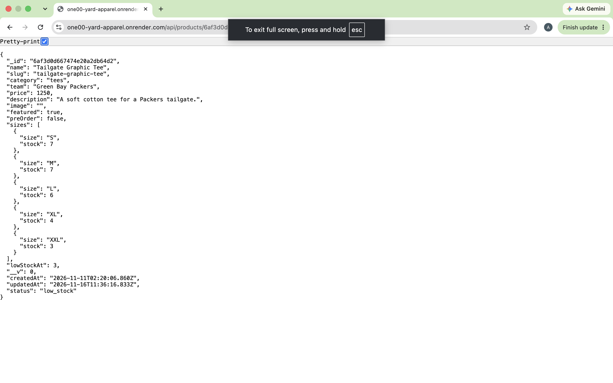
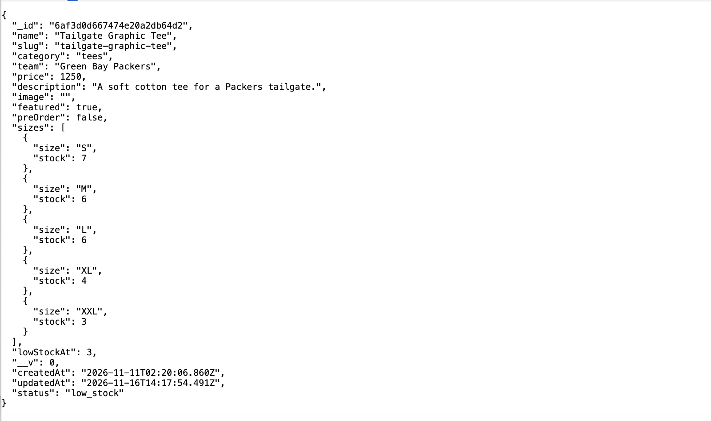
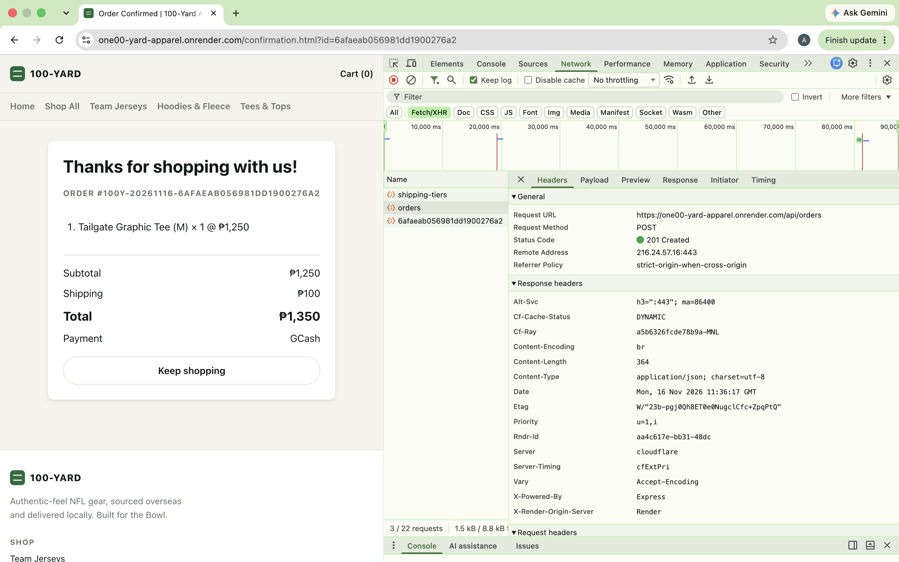
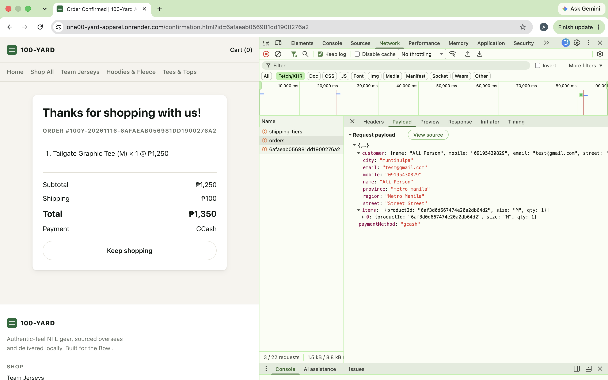
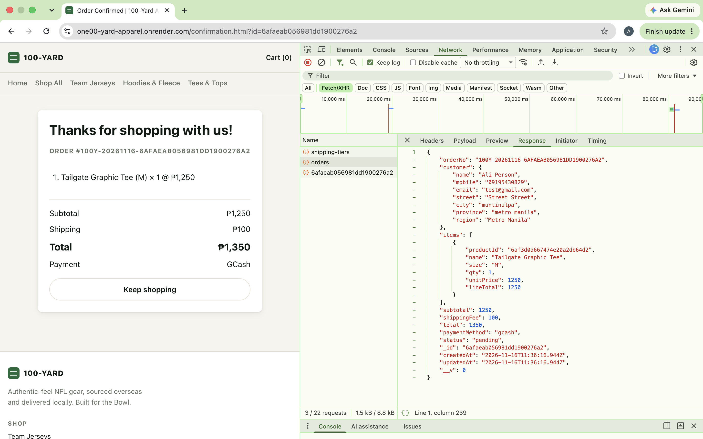
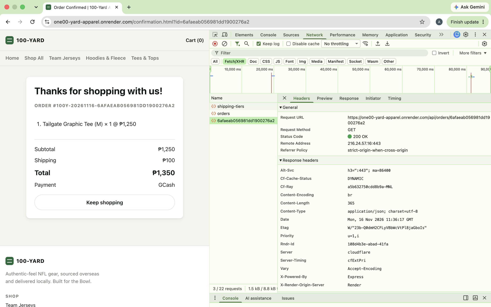
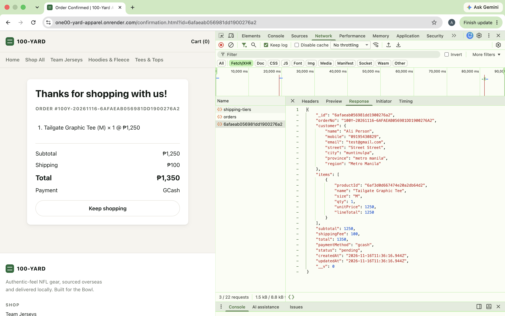
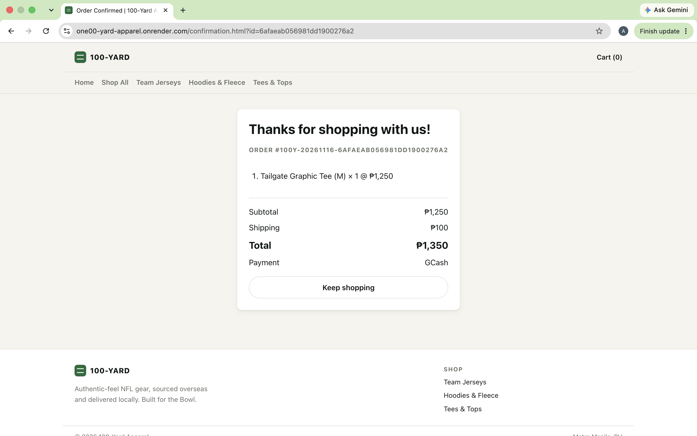
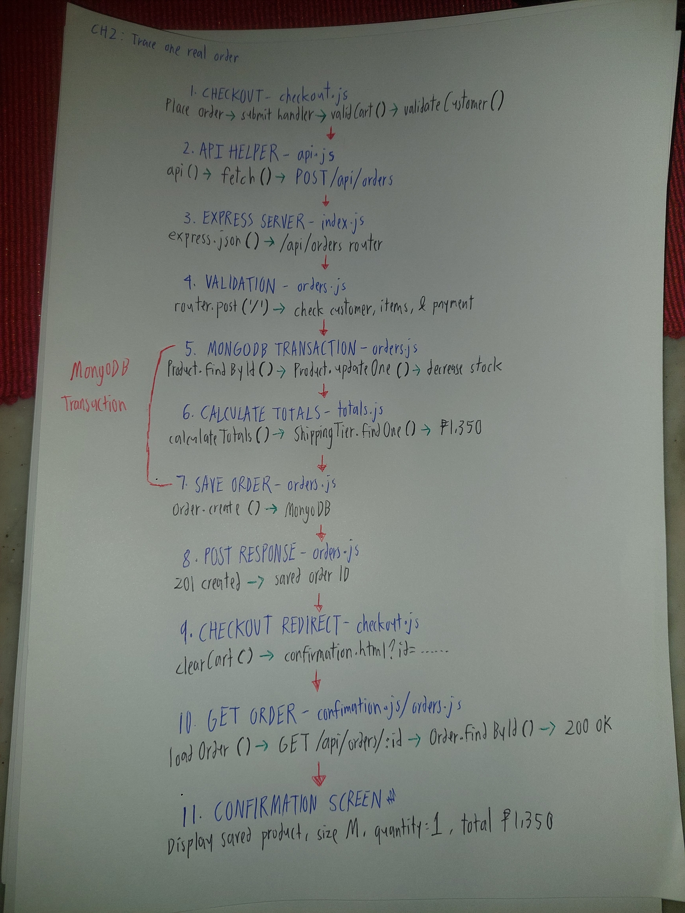

## Challenge 2 — Trace One Real Request

**Member:** Ali Custodio (M5)  
**Issue:** #46  
**Test website:** https://one00-yard-apparel.onrender.com

### Test Order

I placed a test order on the deployed website with the Network tab open to trace the request from Checkout to Confirmation.

- Product: Tailgate Graphic Tee 
- Size: M
- Quantity: 1
- Order ID: `6afaeab056981dd1900276a2`


### Network Results

| Detail | Result |
| --- | --- |
| Request method | `POST` |
| Request URL | `https://one00-yard-apparel.onrender.com/api/orders` |
| Request body | [See POST Payload screenshot](images/challenge2/c2-post-payload.png) |
| POST status | `201 Created` |
| POST response | [See POST Response screenshot](images/challenge2/c2-post-response.png) |
| Confirmation request | `GET /api/orders/6afaeab056981dd1900276a2` |
| GET status | `200 OK` |
| GET response | Saved order details, including purchased items and final total |


### POST Request Body

The Checkout form sent the following JSON to the server:

```json
{
  "customer": {
    "name": "Ali Person",
    "mobile": "09195430829",
    "email": "test@gmail.com",
    "street": "Street Street",
    "city": "muntinulpa",
    "province": "metro manila",
    "region": "Metro Manila"
  },
  "items": [
    {
      "productId": "6af3d0d667474e20a2db64d2",
      "size": "M",
      "qty": 1
    }
  ],
  "paymentMethod": "gcash"
}
```

### POST Response Body

The server returned `201 Created` with the following saved order details:

```json
{
  "orderNo": "100Y-20261116-6AFAEAB056981DD1900276A2",
  "customer": {
    "name": "Ali Person",
    "mobile": "09195430829",
    "email": "test@gmail.com",
    "street": "Street Street",
    "city": "muntinulpa",
    "province": "metro manila",
    "region": "Metro Manila"
  },
  "items": [
    {
      "productId": "6af3d0d667474e20a2db64d2",
      "name": "Tailgate Graphic Tee",
      "size": "M",
      "qty": 1,
      "unitPrice": 1250,
      "lineTotal": 1250
    }
  ],
  "subtotal": 1250,
  "shippingFee": 100,
  "total": 1350,
  "paymentMethod": "gcash",
  "status": "pending",
  "_id": "6afaeab056981dd1900276a2",
  "createdAt": "2026-11-16T11:36:16.944Z",
  "updatedAt": "2026-11-16T11:36:16.944Z",
  "__v": 0
}
```


### Code Trace

The following traces the successful test order from the Checkout button to the database and Confirmation page.

**1. Button handler — `public/js/checkout.js`**

The `form.addEventListener('submit', async event => {...})` handler runs when the customer clicks Place Order. It prevents the default form submission, checks the Cart using `validCart()`, collects the customer details and payment method, and checks the inputs using `validateCustomer()`.

For this test, the Cart contained one Tailgate Graphic Tee, size M. The handler maps the Cart into an `items` array containing the product ID, size, and quantity. It also sets `submitting = true` and disables the Place Order button through `updateButton()` to prevent duplicate submissions.

**2. API request — `public/js/checkout.js` and `public/js/api.js`**

The Checkout handler calls `api('/api/orders', { method: 'POST', body: { customer, items, paymentMethod } })`.

The exported `api()` function in `public/js/api.js` sets the `Content-Type` header to `application/json`, converts the body using `JSON.stringify()`, and sends the request using `fetch()`.

Chrome DevTools confirmed that the browser sent `POST https://one00-yard-apparel.onrender.com/api/orders`.

**3. Express routing — `server/index.js` and `server/routes/orders.js`**

In `server/index.js`, `app.use(express.json())` parses the incoming JSON request. The line `app.use('/api/orders', require('./routes/orders'))` directs requests under `/api/orders` to the Orders router.

In `server/routes/orders.js`, the `router.post('/', async (req, res, next) => {...})` handler receives the request and extracts `customer`, `items`, and `paymentMethod` from `req.body`.

**4. Server-side validation — `server/routes/orders.js`**

The POST handler validates that the required customer fields are not empty using `isNonEmptyString()`. It also checks the Philippine mobile number format and email format.

The handler verifies that the order contains at least one item and that the payment method is `gcash`, `maya`, or `cod`. For every item, it checks the product ID using `mongoose.isObjectIdOrHexString()`, requires a quantity from 1 to 3, requires a size, and rejects duplicate product-and-size lines.

Invalid requests produce errors through `createError()`. The successful `201 Created` result indicates that this test order passed the relevant validation checks.

**5. Product lookup and stock update — `server/routes/orders.js`**

The server starts a MongoDB session using `mongoose.startSession()` and processes the order inside `session.withTransaction()`.

For each item, `Product.findById(productId).session(session)` retrieves the product. The handler locates the requested size using `product.sizes.find()`.

It then uses `Product.updateOne()` with `$inc` to decrease the stock of the selected size. The update condition checks that enough stock remains using `$gte`. If no matching stock is available, the server throws a `409` insufficient-stock error.

For this test, one unit of size M was ordered.

The server does not trust product names or prices supplied by the browser. The POST request only includes the product ID, size, and quantity for each item; it does not include `name`, `unitPrice`, or totals. The server retrieves the Product document using `Product.findById()` and copies the current `product.name` and `product.price` into the saved order items. The final subtotal, shipping fee, and total are then calculated on the server using `calculateTotals()`.

**6. Server-side total calculation — `server/services/totals.js`**

After preparing the order items, the POST handler calls `calculateTotals(orderItems, customer.region.trim())`.

The `calculateTotals()` function calculates the subtotal using the product prices and quantities. It uses `ShippingTier.findOne({ region, active: true }).lean()` to retrieve the shipping rules for the chosen region and checks whether the order qualifies for free shipping.

The saved response confirmed:
- Subtotal: ₱1,250
- Shipping fee: ₱100
- Total: ₱1,350

These totals were calculated on the server rather than relying on the Checkout page's estimated values.

For this test order, the selected shipping region was Metro Manila. The configured shipping tier has a `fee` of ₱100 and a `freeShippingMin` of ₱5,000. Since the Tailgate Graphic Tee subtotal was ₱1,250, which is below the free-shipping threshold, `calculateTotals()` applied the ₱100 fee. This produced a server-calculated total of ₱1,350.


**7. Database save — `server/routes/orders.js`**

Inside the same MongoDB transaction, the handler generates a unique order ID using `new mongoose.Types.ObjectId()` and constructs the order number.

It builds the `orderData` object containing the customer information, purchased items, server-calculated totals, and payment method.

The function `Order.create([orderData], { session })` saves the order in MongoDB. The saved document is stored in `savedOrder`.

**8. Server response — `server/routes/orders.js`**

After the transaction completes, the server returns `res.status(201).json(savedOrder)`.

Chrome DevTools showed `201 Created` and the saved order with ID `6afaeab056981dd1900276a2`, order number `100Y-20261116-6AFAEAB056981DD1900276A2`, and status `pending`.


**9. Checkout redirect — `public/js/checkout.js`**

After the server returns an order with a valid `_id`, the Checkout handler calls `clearCart()`, imported from `public/js/cart-store.js`. This function removes the `100yard-cart` key from localStorage.

The Cart is cleared immediately after the successful POST response. The Checkout handler then redirects the browser using:

`window.location.href = 'confirmation.html?id=' + encodeURIComponent(order._id)`

The Place Order button stays disabled during the successful redirect because `submitting` remains `true`. It is only reset to `false` if submission fails, preventing duplicate orders.

**10. Confirmation request — `public/js/confirmation.js` and `server/routes/orders.js`**

The `loadOrder()` function in `public/js/confirmation.js` reads the order ID from the page URL using `URLSearchParams`. It calls `api('/api/orders/' + encodeURIComponent(id))` to retrieve the saved order.

The GET request reaches `router.get('/:id', async (req, res, next) => {...})` in `server/routes/orders.js`. The server checks the ID format, retrieves the order using `Order.findById(req.params.id)`, and returns `res.status(200).json(order)`.

Chrome DevTools confirmed that `GET /api/orders/6afaeab056981dd1900276a2` returned `200 OK`.


**11. Confirmation rendering — `public/js/confirmation.js`**

After receiving the GET response, `loadOrder()` displays the saved order number, subtotal, shipping fee, total, payment method, and purchased items.

It uses `document.getElementById()` to update the page and loops through `order.items` to create the purchased-item entries.

After successfully retrieving the saved order, `loadOrder()` also calls `localStorage.removeItem(CART_KEY)` and updates the Cart count using `refreshCartCount()`. This serves as a backup cleanup if the Confirmation page is opened directly or Checkout did not finish clearing the Cart.

Therefore, both pages perform Cart cleanup, but the main clearing happens in Checkout immediately after the successful POST response.


### Findings

The test order was successfully submitted through Checkout on the deployed website. The `POST /api/orders` request returned `201 Created`, confirming that the server saved the order.

The order contained one Tailgate Graphic Tee, size M, priced at ₱1,250, with a ₱100 shipping fee and a final total of ₱1,350. The response included a unique order ID and the status `pending`.

The Confirmation page then sent `GET /api/orders/6afaeab056981dd1900276a2`, which returned `200 OK`. The saved product and total matched the details displayed on the Confirmation page.


### Additional Stock Verification

To verify the inventory update performed by `Product.updateOne()`, I conducted a separate test on the deployed website.

I retrieved the product through `GET /api/products/:id` before placing the order and recorded the selected size's available stock. After successfully placing an order for one unit, I requested the same product again.

- Product: Tailgate Graphic Tee
- Product ID: `6af3d0d667474e20a2db64d2`
- Size: M
- Stock before: 7
- Quantity purchased: 1
- Stock after: 6

The before-and-after results show that the selected size's available stock decreased by one after the successful order.






### Evidence

**1. POST request headers**



**2. POST request payload**

 

**3. POST response**



**4. GET request headers**



**5. GET response**



**6. Confirmation page**



**7. Hand-drawn diagram**


