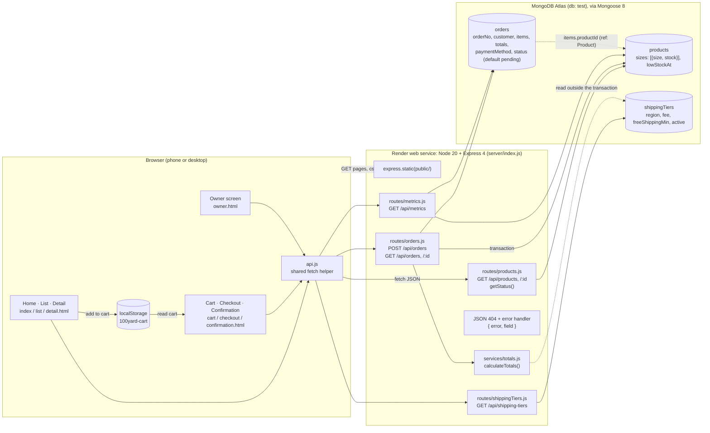
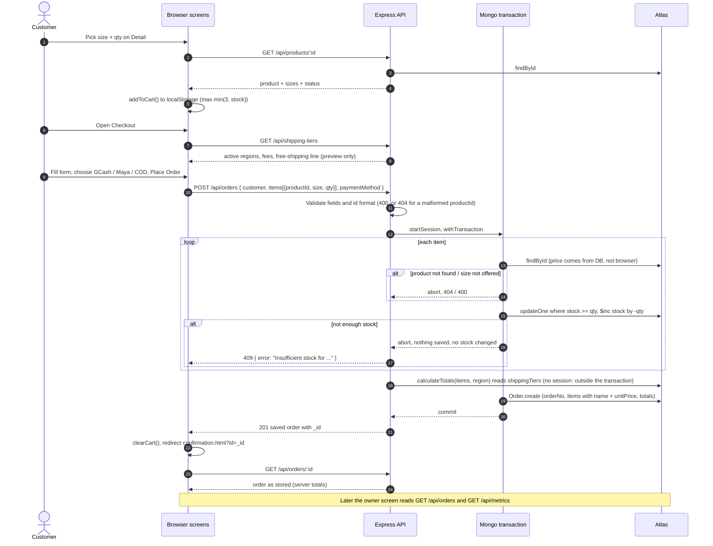

# System diagram and order data flow

100-Yard Apparel runs as one Render web service. Express serves both the screens in `public/` and the JSON API, so the browser talks to a single URL (https://one00-yard-apparel.onrender.com). All data lives in MongoDB Atlas (database `test`).

## 1. Front end → back end → database

| Layer | What it holds | Key files |
| --- | --- | --- |
| Front end | One HTML file per screen, ES-module scripts, cart in `localStorage` (`100yard-cart`, max 3 per line) | `public/*.html`, `public/js/api.js`, `public/js/cart-store.js` |
| Back end | Express app, one router per resource, shared money logic, one error shape for every 4xx | `server/index.js`, `server/routes/*.js`, `server/services/totals.js` |
| Database | Three collections; product status is computed, not stored. Order items reference `products` by `productId` but keep a copied `name` and `unitPrice`, so an order still displays correctly if the product later changes | `server/models/*.js`, `server/seed.js` |

## 2. Data flow: placing an order

### Step by step

1. **Select (Detail).** `GET /api/products/:id` returns the product with stock per size and a `status` computed by `getStatus()`. The customer picks a size and a quantity up to `min(3, stock)`, and `addToCart()` stores `{ productId, name, price, size, qty }` in `localStorage`.
2. **Review (Cart).** The cart re-fetches each product so the shopper sees current prices and stock before checking out.
3. **Confirm (Checkout).** `GET /api/shipping-tiers` fills the region dropdown and previews the shipping fee and free-shipping line. Place Order sends `POST /api/orders` through `api.js` with only ids, sizes and quantities. **No prices or totals are sent.**
4. **Validate.** Before the transaction, the server checks every customer field (mobile `09XXXXXXXXX`, email format), that `items` is not empty, that each `productId` is a valid id format, that `qty` is a whole number from 1 to 3, that there are no duplicate product-and-size lines, and that `paymentMethod` is `gcash`, `maya` or `cod`. Failures return 400 (404 for a malformed `productId`) as `{ error, field }`.
5. **Save, all or nothing.** Inside one MongoDB transaction, for each line the server:
   - loads the product and takes its price from the database (a well-formed but nonexistent `productId` returns 404 here; a size the product doesn't offer returns 400)
   - reduces stock with a conditional update that only matches when `stock >= qty`

   If any line can't be filled, the transaction aborts and returns **409**: nothing is saved and no stock changes. Otherwise `calculateTotals(items, region)` reads the region's row in `shippingTiers` (this read does not use the session, so it runs outside the transaction; an unknown region still aborts the order with 400) and returns `subtotal`, `shippingFee` (₱0 when `freeShippingMin > 0` and subtotal ≥ `freeShippingMin`) and `total`. The order is saved with `orderNo`, copied item names and unit prices, and `status: pending`, and the transaction commits.
6. **Read back (Confirmation).** The 201 response carries the order `_id`. Checkout clears the cart and redirects to `confirmation.html?id=…`, which reads `GET /api/orders/:id` and shows the server's totals.
7. **Owner.** The owner screen loads `GET /api/orders` (newest first) and `GET /api/metrics` (order count, revenue, average order value, top seller, low-stock sizes), all computed from saved data.
